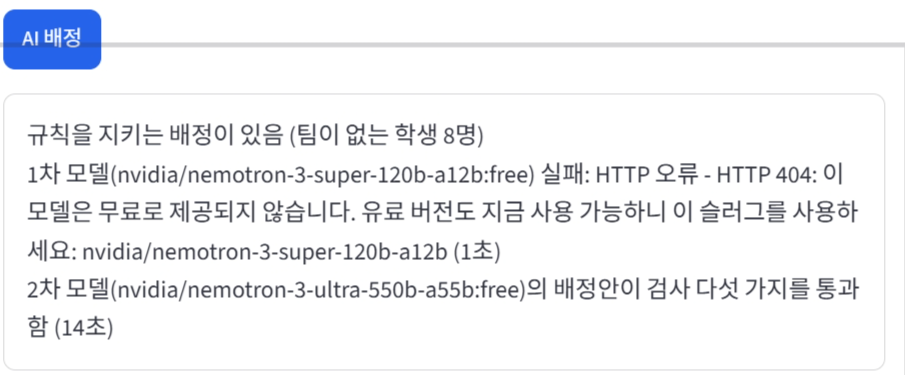
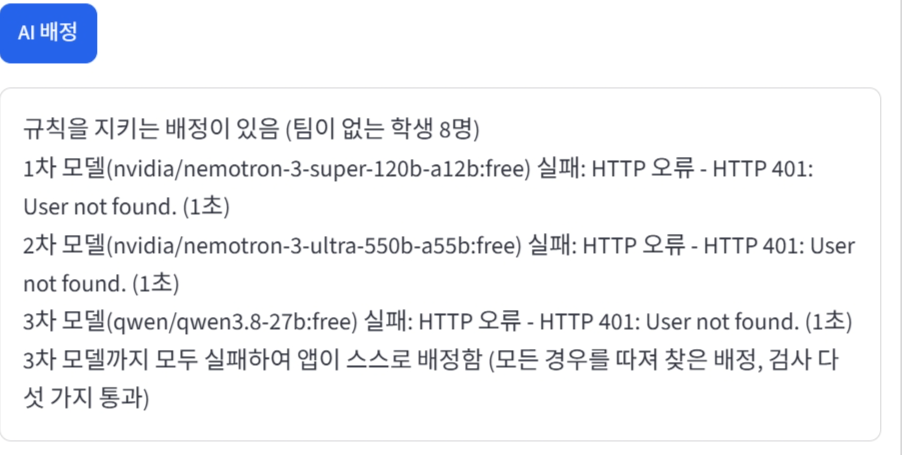
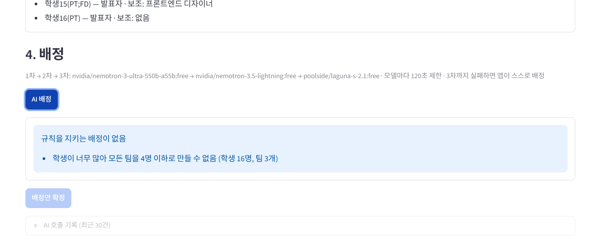
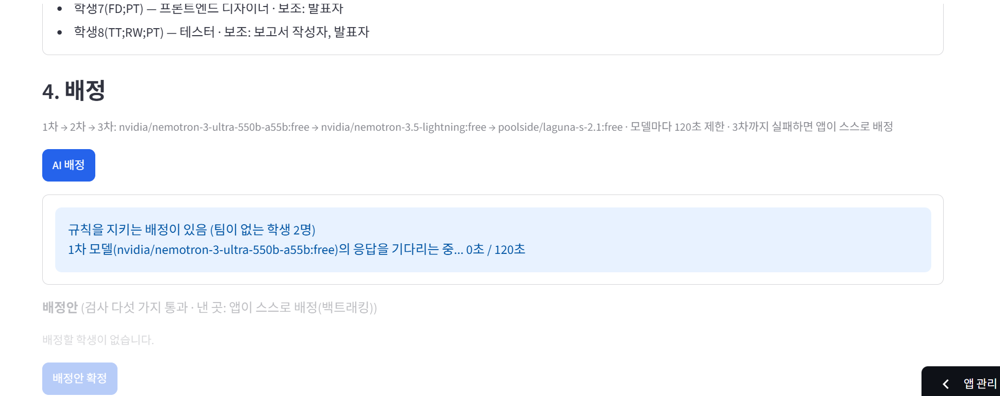

# 팀 편성 웹 앱 (Team Former)

학생들이 팀 프로젝트를 위한 팀을 스스로 편성하는 웹 앱이다. 학생은 팀에 지원하고, 팀원들이 투표로 받아들일지 정한다. 모집을 마감한 뒤 팀이 없는 학생은 AI(OpenRouter 무료 모델 1차→2차→3차)가 배정안을 내고, 앱이 그 배정안을 규칙 다섯 가지로 검사한다. AI가 모두 실패하면 앱이 모든 경우를 따져(백트래킹) 스스로 배정한다.

- 작성자: 전수민
- 스택: Streamlit Community Cloud, Supabase(PostgreSQL, `tf_` 테이블), psycopg 3 연결 풀, bcrypt, OpenRouter

## 1. 배포 주소

https://2026-web-programing-tf-teamformer.streamlit.app/

## 2. PRD와 구현 계획의 위치

- PRD: [`docs/PRD.md`](docs/PRD.md)
- 구현 계획: [`docs/구현 계획.md`](docs/구현%20계획.md)
- 개발·시험 기록: [`docs/개발 기록.md`](docs/개발%20기록.md)
- DB 스키마: [`schema.sql`](schema.sql)

## 3. 고른 해결 방법

| 기능 | 고른 해결 | 어떻게 만들었나 |
|---|---|---|
| 다른 사람의 변경 보기 | **어려운 해결** | `st.fragment(run_every=3)`로 팀 목록, 투표 단추, 팀이 없는 학생 표시를 3초마다 바뀐 부분만 다시 그림 (`tfapp/ui_student.py`, `tfapp/ui_admin.py`) |
| 필수 포함 역할을 지킬 수 없는 팀 | **어려운 해결** | 지원 단계에서 "남는 자리 < 아직 못 채운 필수 포함 역할 수"이면 막음. 기획자와 웹 프로그래머는 서로 다른 학생이 맡도록 최대 매칭으로 셈 (`tfapp/rules.py`의 `required_filled`, `check_join`) |
| 같은 팀에 대기 중인 지원이 여럿 | **어려운 해결** | 마지막 찬성으로 투표가 끝나는 순간 정원, 주 역할 중복, 필수 포함 역할 자리를 다시 검사함. 처리 순서는 투표가 끝난 순서 (`tfapp/service.py`의 `vote`) |
| 마지막 자리에 두 명이 동시에 들어감 | **어려운 해결** | `tf_members`의 `(team_id, slot_no)` 기본 키와 `student_id` 유일 제약, 대기 지원 부분 유일 인덱스. 처리 중에는 팀 행을 `SELECT … FOR UPDATE`로 잠금 (`schema.sql`) |
| AI 응답이 늦을 때 | **어려운 해결** | 모델마다 부른 때부터 응답을 다 받을 때까지 **전체 120초**를 재서 끊음. 응답이 조금씩 계속 와도 120초에서 끊고 다음 모델로 넘어감 (`tfapp/ai.py`의 `call_openrouter`) |
| 3차 모델까지 실패 | **어려운 해결** | 검사 다섯 가지를 모두 통과하는 배정을 백트래킹으로 끝까지 찾음. 규칙을 지키는 배정이 없으면 AI를 부르지 않고 이유를 보여 줌 (`tfapp/rules.py`의 `solve`, `explain_infeasible`) |
| AI 대기 중 화면 | **어려운 해결** | "2차 모델(모델 이름)의 응답을 기다리는 중... 37초 / 120초"처럼 몇 차 모델을 기다리는지와 경과 시간을 1초마다 보여 줌 |
| DB 일시정지 막기 | **어려운 해결** | GitHub Actions 예약 작업이 매일 09:17(한국 시각)에 DB에 질의함 (`.github/workflows/keepalive.yml`) |

## 4. 쓴 모델 3개

- 1차 `nvidia/nemotron-3-ultra-550b-a55b:free`
- 2차 `nvidia/nemotron-3.5-lightning:free`
- 3차 `poolside/laguna-s-2.1:free`

10/31에 후보 모델을 실제로 불러 보고 골랐다(`test_models.py`). 3차는 1·2차와 제공사가 달라 NVIDIA 쪽이 한꺼번에 막혀도 대비가 된다.

## 5. 오픈라우터 AI 모델 호출 실패 사례

**사례 1: 1차 모델이 무료가 아니게 되어 404 → 2차 모델로 넘어감 (10/31)**
1차 `nvidia/nemotron-3-super-120b-a12b:free`가 `HTTP 404: 이 모델은 무료로 제공되지 않습니다`로 실패했다. 앱은 자동으로 2차 `nvidia/nemotron-3-ultra-550b-a55b:free`로 넘어갔고, 2차의 배정안이 검사 다섯 가지를 통과했다(14초).



**사례 2: 1~3차 모두 401 → 앱이 스스로 배정함 (10/31)**
OpenRouter 키를 잘못 넣어 1~3차가 모두 `HTTP 401: User not found`로 실패했다. 3차까지 실패하자 앱이 백트래킹으로 찾은 배정을 보여 주었다.



## 6. 클로드가 잘못된 추론이나 답변을 한 사례

**사례 1: 이미 무료가 아닌 모델을 1차로 추천함**
- 클로드가 10/19에 웹 검색으로 1차 `nvidia/nemotron-3-super-120b-a12b:free`(공고 예시와 같은 모델), 3차 `qwen/qwen3.8-27b:free`를 추천했다.
- 알아챈 방법: 10/31 실제 키로 연습용 쉬움 명단을 마감하고 AI 배정을 눌러 보니, 1차가 `HTTP 404: 무료로 제공되지 않음`으로 실패했다(위 5장 사례 1의 화면 `img/img-ai-fallback.png`). 이어서 `test_models.py`로 후보를 시험하니 3차 qwen도 404였다.
- 고침: 실제로 통과한 모델로 1~3차를 다시 정했다(`tfapp/config.py`의 `DEFAULT_MODELS`).

**사례 2: AI 120초 제한이 실제로는 늦게 끊기는 코드를 만듦**
- 클로드가 처음 만든 `call_openrouter`는 제한 시간이 지나면 "시간 초과"를 내기는 했지만, 읽는 중인 연결을 메인 스레드에서 닫느라 그 호출이 막혀서 **제한 3초인데 실제로는 20초 뒤에** 돌아왔다.
- 알아챈 방법: 1초마다 유지 신호만 보내는 가짜 서버로 시험했다. `tests/test_ai_http.py::test_total_timeout_cuts`의 "3초 근처에서 끊겨야 함" 검사가 실패했다(걸린 시간 20.0초).
- 고침: 연결 닫기를 별도 스레드에서 하고(소켓 `shutdown`), 메인은 바로 다음 모델로 넘어가게 했다. 다시 시험하니 3.0초에 끊겼다. 자세한 내용은 `docs/개발 기록.md` 2.1절에 있다.

## 7. 앱에서 발견한 문제점이나 개선 필요 사항

배포 앱으로 부록 1(쉬움) 시나리오를 1~6단계까지 해 보았다(10/31). 모든 단계의 결과 안내가 기대 결과와 같았고, 6단계에서 팀이 없는 학생 2명(학생7, 학생8)을 1차 모델이 8초 만에 배정해 확정한 팀 3개가 모두 규칙을 지켰다([배정안](img/step6-proposal.png), [확정 결과](img/step6-final.png)). 그 과정에서 찾은 문제는 다음과 같다.

**문제 1: 팀 수를 잘못 넣어도 명단 올리기 단계에서 막지 않음**
- 발견한 곳: 부록 3(어려움)을 준비하며 `어려움.csv`(16명)로 처음 상태 만들기를 할 때, 팀 수를 4가 아니라 실수로 3으로 넣었다. 16명은 팀 3개(최대 12명)에 들어갈 수 없는데도 명단 올리기는 그대로 승인되었다. 이어서 모집 마감과 AI 배정을 누르고 나서야 진행 상황 상자에 "규칙을 지키는 배정이 없음 — 학생이 너무 많아 모든 팀을 4명 이하로 만들 수 없음 (학생 16명, 팀 3개)"이 나와 실수를 알 수 있었다.
- 영향: 실제로 쓴다면 학생들이 지원과 투표를 모두 마친 뒤 배정 단계에서야 잘못을 알게 되고, 명단을 다시 올려 처음부터 해야 한다.
- 화면: [`img/team-count-infeasible.png`](img/team-count-infeasible.png)

  
- 개선 방향: 명단을 올릴 때 학생 수가 팀 수 × 4보다 많거나 팀 수 × 2보다 적으면 `막힘`으로 막고 이유를 보여 주기. 기획자나 웹 프로그래머를 맡을 수 있는 학생 수가 팀 수보다 적을 때도 미리 경고하기

**문제 2: AI 배정을 기다리는 동안 관리자 화면이 그 작업에 묶임**
- 발견한 곳: 부록 1(쉬움) 6단계 "관리자가 마감하고 배정". 처음 상태 만들기 → 1~5단계 → 마감 뒤 AI 배정을 누르자, 진행 상황 상자에 "규칙을 지키는 배정이 있음 (팀이 없는 학생 2명)", "1차 모델(nvidia/nemotron-3-ultra-550b-a55b:free)의 응답을 기다리는 중... 0초 / 120초"가 나오고, 응답이 올 때까지 관리자는 끝나기를 기다려야 했다. 같은 날 앞서 한 쉬움 6단계에서는 1차 모델이 8초 만에 끝났지만, 무료 모델이 느리면 최악의 경우 모델 3개 × 120초 = 6분 동안 기다려야 한다.
- 화면: [`img/step6-waiting.png`](img/step6-waiting.png)

  
- 개선 방향: AI 호출을 백그라운드 작업으로 돌리고, 진행 상황은 자동 갱신(`st.fragment`)으로만 보여 주어 기다리는 동안에도 관리자가 현황을 보거나 다른 작업을 할 수 있게 하기

## 실행 방법 (로컬)

```
pip install -r requirements.txt
streamlit run streamlit_app.py
```

`.env`(깃허브에 올리지 않음)에 `OPENROUTER_API_KEY`, `DATABASE_URL`, `ADMIN_PASSWORD`를 넣는다. 형식은 `.env.example`을 따른다. 앱이 시작할 때 `schema.sql`로 테이블이 없으면 만들고, `ADMIN_PASSWORD`로 관리자 계정(`admin`)을 만들거나 비밀번호를 갱신한다.

## 시험

```
pytest tests/test_rules.py tests/test_ai_http.py            # DB 없이
TEST_DATABASE_URL=postgresql://... pytest tests/test_scenarios.py   # 시험용 DB 필요(모든 tf_ 테이블을 지우고 다시 만듦)
```

`tests/test_scenarios.py`는 부록의 연습용 시나리오 3개를 단계마다 실행해 결과 안내의 첫 단어를 확인한다. 앱 코드는 학생 이름이나 시나리오 순서를 보지 않고 규칙으로만 판정한다.

## 폴더 구조

```
streamlit_app.py      진입점(로그인, 화면 나눔)
tfapp/config.py       비밀 값 읽기(st.secrets → .env), 모델 목록
tfapp/db.py           연결 풀(한 번만 만들어 재사용), 오류 메시지에서 DB 주소 가림
tfapp/auth.py         bcrypt 해시, 로그인, 관리자 계정
tfapp/rules.py        규칙 판정(순수 함수): 필수 역할 매칭, 지원 검사, 배정안 검사, 백트래킹
tfapp/service.py      트랜잭션: 명단 초기화, 지원, 투표, 마감, 배정안 저장, 확정
tfapp/ai.py           OpenRouter 호출(120초 전체 제한), 1→2→3차, 앱 스스로 배정
tfapp/ui_*.py         학생 화면, 관리자 화면
schema.sql            tf_ 테이블과 제약
```
